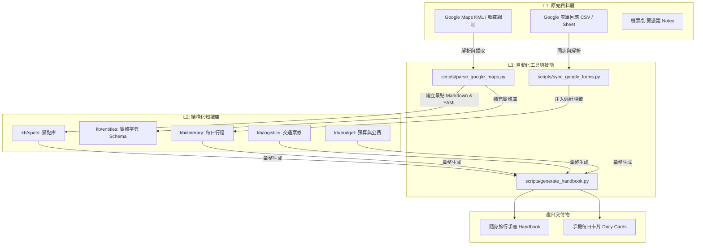

# 2026 日本秋季自由行規劃專案 (202611JapanTrip)

> 本專案為個人與同行夥伴的 **2026 年 11 月日本自由行** 智慧策劃知識庫（Second Brain）。
> 整合 **Google 表單問卷（夥伴需求與願望清單）** 與 **Google Maps / My Maps（景點標記與路徑）**，採用 L1-L4 四層知識結構進行雙向連結與自動化排程。

---

## 快速導覽 (Quick Navigation)

| 層級 | 資料夾 / 檔案 | 說明 |
|:---|:---|:---|
| **L4 策略指引** | [`AGENTS.md`](file:///c:/Users/hugoy/OneDrive/桌面/202611JapanTrip/AGENTS.md) / [`CLAUDE.md`](file:///c:/Users/hugoy/OneDrive/桌面/202611JapanTrip/CLAUDE.md) | AI 旅遊規劃師角色、核心規範與記憶架構 |
| **L4 索引總圖** | [`INDEX.md`](file:///c:/Users/hugoy/OneDrive/桌面/202611JapanTrip/INDEX.md) / [`kb/AI_Context_Map.md`](file:///c:/Users/hugoy/OneDrive/桌面/202611JapanTrip/kb/AI_Context_Map.md) | 景點 ↔ 交通 ↔ 住宿 ↔ 預算 ↔ 每日行程 關聯地圖 |
| **L2 結構知識庫** | [`kb/`](file:///c:/Users/hugoy/OneDrive/桌面/202611JapanTrip/kb/INDEX.md) | 包含行程、景點庫、交通票券、住宿、預算公費、打包清單與實體字典 |
| **L1 原始資料** | [`raw/`](file:///c:/Users/hugoy/OneDrive/桌面/202611JapanTrip/raw/INDEX.md) | Google 表單問卷回應、Google Maps KML 匯出、機票住宿訂單憑證 |
| **L3 自動化腳本** | [`scripts/`](file:///c:/Users/hugoy/OneDrive/桌面/202611JapanTrip/scripts) | Google 表單同步器、Google Maps KML/網址解析器、隨身手冊生成器 |
| **L3 專案技能** | [`.agents/skills/`](file:///c:/Users/hugoy/OneDrive/桌面/202611JapanTrip/.agents/skills) | 行程優化 (`trip-planner`)、表單同步 (`gforms-syncer`)、地圖解析 (`gmaps-parser`) |
| **產出交付物** | [`output/`](file:///c:/Users/hugoy/OneDrive/桌面/202611JapanTrip/output/INDEX.md) | 隨身列印小手冊（Handbook）與手機閱讀每日行動卡片（Daily Cards） |

---

## 核心工作流 (Workflow)



---

## 如何開始使用

### 1. 存取與同步 Google 表單內容
1. 將 Google 表單所連結的 **Google Sheet** 設為「發布至網路 (CSV)」或複製其共用網址。
2. 複製 `config/google_config.example.yaml` 為 `config/google_config.yaml` 並填入 Sheet 網址（或將匯出的 CSV 放入 `raw/google_forms/`）。
3. 執行同步腳本：
   ```bash
   python scripts/sync_google_forms.py
   ```

### 2. 存取與解析 Google Maps / 我的地圖
1. 在 Google My Maps（我的地圖）中將景點清單匯出為 **KML / KMZ** 檔案，放入 `raw/google_maps/`。
2. 或將 Google Maps 景點分享網址清單寫入 `raw/google_maps/places_urls.txt`。
3. 執行解析腳本：
   ```bash
   python scripts/parse_google_maps.py
   ```
   腳本會自動在 `kb/spots/` 產生結構化的景點 Markdown 卡片，並同步更新 `kb/entities/spots_vocabulary.yaml`。

### 3. 生成隨身手冊
```bash
python scripts/generate_handbook.py
```
產出完整離線隨身手冊至 `output/handbook/`。
