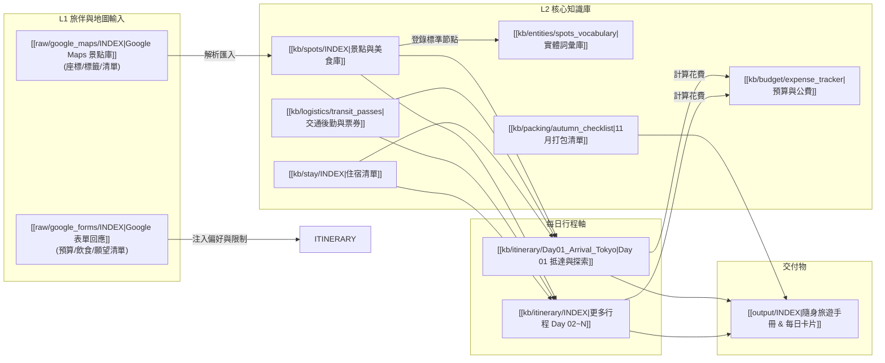

# 2026 日本自由行全域知識關聯地圖 (AI Context Map)

> **目的**：供 AI 與人類快速綜覽行程、景點、交通、住宿與旅伴偏好之間的雙向依賴關係，避免資訊孤島與排程衝突。

---

## 1. 系統依賴關聯圖 (Dependency Graph)

---

## 2. 核心實體關聯對照表 (Entity Links)

### 2.1 每日行程與景點/住宿/交通關聯

- [[kb/itinerary/Sendai_202611_Replan_Draft|2026-11-09 六天精簡重排草案]] 串接住宿時間、交通時刻、食べログ與紅葉現況，含猊鼻溪替換與分段自駕方案。
- **Day 01 抵達仙台 ➔ 國分町**：
  - 交通：[[kb/logistics/transit_passes#day-1-抵達仙台機場--仙台市區|仙台機場 Access 線]] + 地下鐵南北線
  - 景點：國分町美食商圈、味太助牛舌、定禪寺通
  - 住宿：[[kb/logistics/accommodations#night-1--night-2|HOTEL LiVEMAX Sendai Kokubuncho]]

- **Day 02 仙台歷史文化巡禮**：
  - 交通：[[kb/logistics/transit_passes#day-2-仙台市區歷史巡禮-るーぷる仙台單向順行環線|るーぷる仙台觀光循環巴士]]
  - 景點：瑞鳳殿、青葉城跡、大崎八幡宮、定禪寺通夜景
  - 住宿：[[kb/logistics/accommodations#night-1--night-2|HOTEL LiVEMAX Sendai Kokubuncho]] (續住免搬行李)

- **Day 03 鹽竈水產市場 (勝手丼) ＋ 鹽竈神社 ➔ 提早入住秋保名湯**：
  - 交通：[[kb/logistics/transit_passes#day-3-仙台--鹽竈水產市場--鹽竈神社--提早入住秋保溫泉綠水亭|JR 仙石線直達 (東鹽釜/本鹽釜)]] + 宮城交通巴士
  - 景點：[[kb/spots/matsushima_shiogama/鹽釜水產市場 1 Chome-20-74 Shinhamacho, S|鹽釜水產物仲卸市場]]、[[kb/spots/matsushima_shiogama/鹽竈神社 1-1 Ichimoriyama, Shiogama, Mi|鹽竈神社・志波彥神社]]、榮太樓本店、浦霞酒造
  - 住宿：[[kb/logistics/accommodations#night-3--night-4|仙台秋保温泉 篝火の湯 緑水亭]] (第 1 晚：提早入住萬坪庭園紅葉 + 篝火之湯 + 會席晚宴)

- **Day 04 秋保溫泉深度度假 ➔ 名瀑工藝與酒廠**：
  - 交通：[[kb/logistics/transit_passes#day-4-秋保溫泉深度度假--磊磊峽--秋保大瀑布--nikka-宮城峽酒廠-連住綠水亭|秋保專線巴士]] + Nikka 接駁車
  - 景點：綠水亭庭園、磊磊峽天然愛心石、秋保工藝之里、Pizza Dottore、秋保大瀑布、Nikka宮城峽蒸餾所
  - 住宿：[[kb/logistics/accommodations#night-3--night-4|仙台秋保温泉 篝火の湯 緑水亭]] (連住第 2 晚免換房打包)

- **Day 05 日本三景松島灣遊船 ➔ 松島木屋包棟自炊**：
  - 交通：[[kb/logistics/transit_passes#day-5-綠水亭退房--松島灣遊船--入住松島包棟木屋--超市採買自炊|JR 仙石線直達]] + 松島計程車
  - 景點：松島灣遊覽船、五大堂透橋、烤牡蠣、The Big 松島店超市大採買
  - 住宿：[[kb/logistics/accommodations#night-5|Matsushima hill bungalow]] (獨立包棟私人木屋・附廚房自炊)

- **Day 06 松島出發 ➔ 仙台站採買 ➔ 機場返台**：
  - 交通：JR 仙石線 + 仙台機場 Access 線
  - 景點：松島木屋晨景、仙台站 S-PAL 名產伴手禮大採買、仙台牛舌午餐

---

## 3. 跨模組約束規則 (Constraints & Rules)

1. **日落時間約束**：
   - 日本 11 月日落時間約在 **16:30 - 17:00**。
   - 戶外自然景點（如庭園、紅葉、富士山景）排在 08:30 - 15:30 之間；夜景或室內購物排在 17:00 之後。
2. **交通轉乘緩衝**：
   - 大車站（如新宿、東京、京都站）轉乘預留 **15-20 分鐘** 緩衝時間；行李託運或置物櫃寄放額外預留 **15 分鐘**。
3. **飲食與同行者偏好**：
   - 每次排定餐廳時，必須反查 `raw/google_forms/`，確認同行者飲食禁忌（例如：是否有海鮮過敏、不吃牛、素食需求）。
