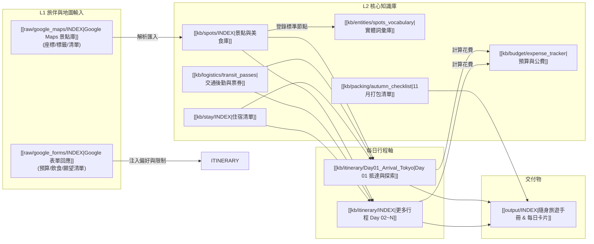

# 2026 日本自由行全域知識關聯地圖 (AI Context Map)

> **目的**：供 AI 與人類快速綜覽行程、景點、交通、住宿與旅伴偏好之間的雙向依賴關係，避免資訊孤島與排程衝突。

---

## 1. 系統依賴關聯圖 (Dependency Graph)

---

## 2. 核心實體關聯對照表 (Entity Links)

### 2.1 每日行程與景點/住宿/交通關聯
- **Day 01 抵達東京**：
  - 交通：[[kb/logistics/transit_passes#成田特快-nex|成田特快 N'EX]] / [[kb/logistics/transit_passes#skyliner|Skyliner]]
  - 景點：[[kb/spots/tokyo/shibuya_sky|SHIBUYA SKY]]、[[kb/spots/tokyo/shibuya_crossing|澀谷十字路口]]
  - 住宿：[[kb/stay/INDEX#東京市區飯店|東京住宿候選]]
  - 旅伴偏好核對：[[raw/google_forms/INDEX#填答摘要|夜景願望清單]]

- **京都賞楓段（預計）**：
  - 景點：[[kb/spots/kansai/kiyomizu_dera|清水寺夜間特別拜觀]]、[[kb/spots/kansai/eikando|永觀堂紅葉]]、[[kb/spots/kansai/arashiyama|嵐山竹林小徑]]
  - 交通：[[kb/logistics/transit_passes#東海道新幹線|東海道新幹線 (Nozomi/Hikari)]]
  - 決策考量：[[kb/decisions/INDEX#賞楓人潮避峰策略|賞楓季清晨出發機制]]

---

## 3. 跨模組約束規則 (Constraints & Rules)

1. **日落時間約束**：
   - 日本 11 月日落時間約在 **16:30 - 17:00**。
   - 戶外自然景點（如庭園、紅葉、富士山景）排在 08:30 - 15:30 之間；夜景或室內購物排在 17:00 之後。
2. **交通轉乘緩衝**：
   - 大車站（如新宿、東京、京都站）轉乘預留 **15-20 分鐘** 緩衝時間；行李託運或置物櫃寄放額外預留 **15 分鐘**。
3. **飲食與同行者偏好**：
   - 每次排定餐廳時，必須反查 `raw/google_forms/`，確認同行者飲食禁忌（例如：是否有海鮮過敏、不吃牛、素食需求）。
